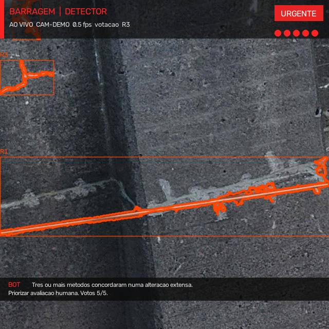
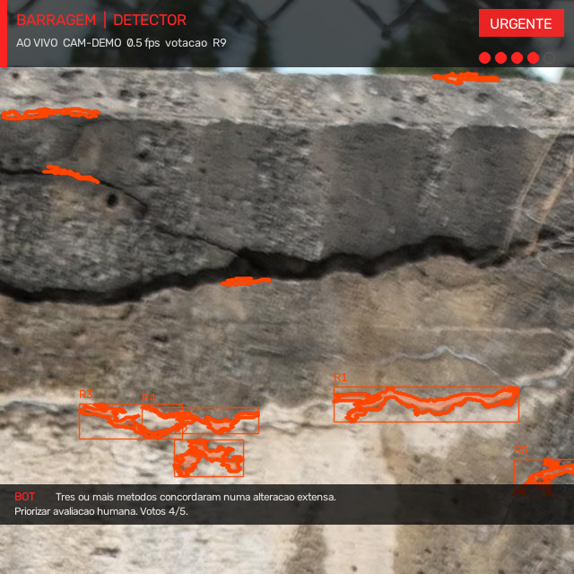
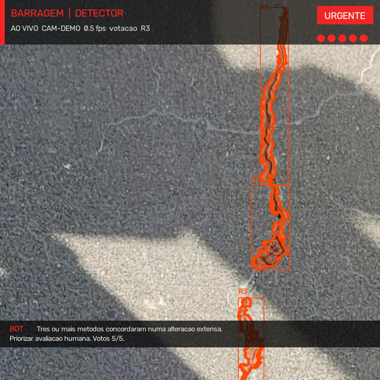
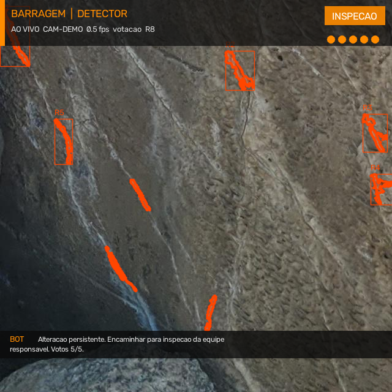
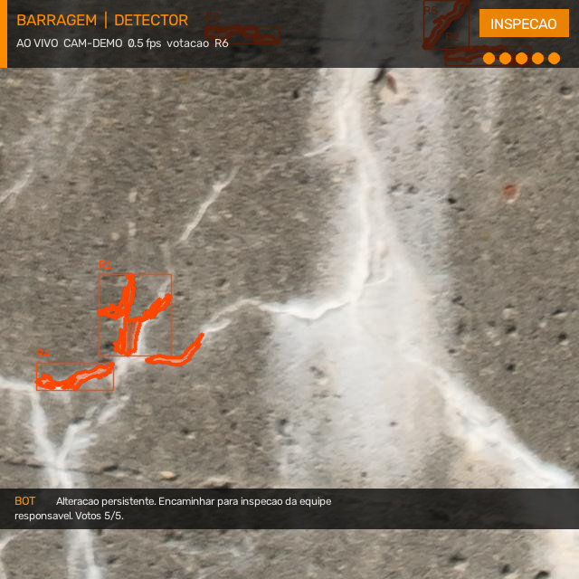
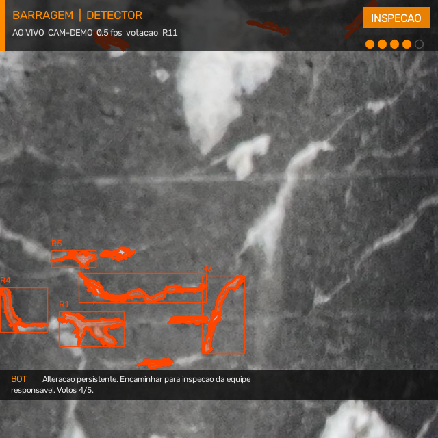
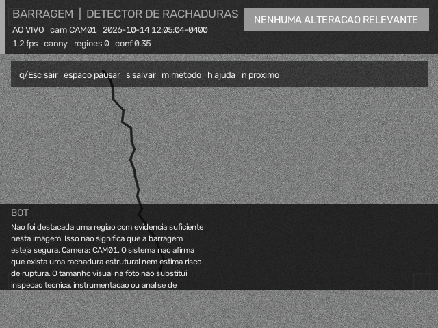
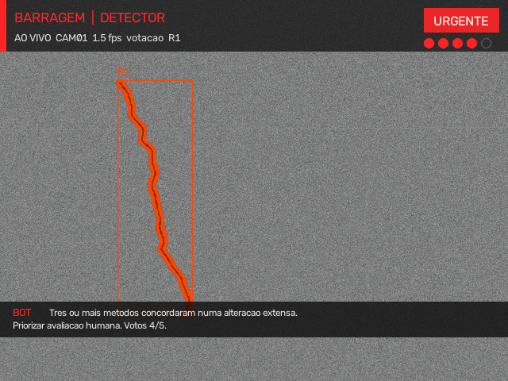

<div align="center">

# 🛡️ DamGuard

### Detector de rachaduras em barragens de concreto com visão computacional

*A câmera observa, o sistema analisa, o alerta informa e o bot explica.*


</div>

---

> ⚠️ **Aviso importante:** o DamGuard é um protótipo para **apoiar o monitoramento visual** de barragens de concreto. Ele **não** diagnostica a estrutura e **não** estima risco de ruptura. Os níveis de alerta são internos do software e **não** são uma classificação oficial de segurança.

## 📑 Sumário

- [Visão geral](#-visão-geral)
- [Início rápido](#-início-rápido)
- [Modos de uso](#-modos-de-uso)
- [Como funciona](#-como-funciona)
- [Níveis de alerta](#-níveis-de-alerta)
- [Controles](#-controles)
- [Scripts auxiliares](#-scripts-auxiliares)
- [Estrutura do projeto](#-estrutura-do-projeto)
- [Dataset DamCrack](#-dataset-damcrack)
- [Licença](#-licença)

## 🔎 Visão geral

O DamGuard analisa imagens, vídeos ou a webcam em busca de possíveis rachaduras em superfícies de concreto. Em vez de confiar em um único detector, ele combina **cinco métodos** que "votam" na mesma região da imagem. Isso reduz falsos alarmes: o aviso mais urgente só aparece quando pelo menos **3 métodos concordam**.

**Destaques**

- 🗳️ **Votação entre 5 métodos** para reduzir falsos positivos
- 🎥 Funciona com **webcam, vídeo ou imagem**
- 🧪 **Modo demo** com concreto sintético: dá para apresentar sem câmera e sem baixar nada
- 🖥️ **HUD ao vivo** com atalhos de teclado e botões clicáveis
- 📊 Scripts de **avaliação (IoU)** e **comparação visual** dos métodos
- 🤖 Bot que explica o que foi detectado

## 🚀 Início rápido

```bash
git clone https://github.com/67ed/PROJETO-BARRAGEM.git
cd PROJETO-BARRAGEM

python -m venv .venv
source .venv/bin/activate.fish   # fish shell
# source .venv/bin/activate      # bash / zsh
# .venv\Scripts\activate         # Windows

pip install -r requirements.txt
python app.py
```

Para rodar sem câmera e sem baixar dataset, use o modo demo: `python app.py --demo`

> 💡 O `--demo` usa o dataset DamCrack se o ZIP estiver disponível. Se não estiver, gera **concreto sintético** na hora.

## 🎮 Modos de uso

| Comando | O que faz |
|---|---|
| `python app.py --demo` | Roda a demonstração (DamCrack ou concreto sintético) |
| `python app.py` | Usa a webcam (se falhar, cai para o modo demo) |
| `python app.py --video clipe.mp4` | Analisa um vídeo |
| `python app.py --imagem foto.jpg` | Analisa uma imagem |
| `python app.py --metodo votacao` | Escolhe o método de detecção |

**Usando o dataset DamCrack (opcional):**

```bash
export DAMCRACK_ZIP="/caminho/para/Damage Segmentaion.zip"
```

## ⚙️ Como funciona

Cinco métodos clássicos analisam a imagem e votam na **mesma região**:

| Método | Papel |
|---|---|
| **Canny** | Detecção de bordas |
| **Top-Hat** | Traços claros |
| **Sobel** | Gradiente |
| **Frangi** | Estruturas alongadas |
| **Modelo treinado** | Escurecimento + borda |

**Pré-processamento antes da votação:**

1. Filtro bilateral
2. CLAHE (realce de contraste local)
3. Remoção de pontos isolados
4. Descarte de método com cobertura acima de 25%

```
📷 Imagem  →  🧹 Pré-processamento  →  🗳️ Votação (5 métodos)  →  🚨 Nível de alerta  →  🤖 Explicação
```

## 🚦 Níveis de alerta

| Nível | Significado |
|---|---|
| ⚪ **nenhum** | Sem anomalia suficiente |
| 🟡 **baixa atenção** | Pouca evidência |
| 🟠 **necessita inspeção** | Concordância entre métodos ou região persistente |
| 🔴 **monitoramento prioritário** | 3 ou mais métodos concordando + região extensa |

> Esses níveis servem só para organizar a interface do software. Eles **não** substituem inspeção feita por profissionais habilitados.

## ⌨️ Controles

| Tecla / clique | Ação |
|---|---|
| `q` ou `Esc` | Sair |
| `espaço` | Pausar / retomar |
| `s` | Salvar frame com HUD |
| `m` | Trocar método |
| `h` | Mostrar / ocultar atalhos |
| `n` | Próxima imagem (modo demo) |
| **PAUSAR** / **SAIR** | Clique na barra inferior |

## 🧰 Scripts auxiliares

```bash
python avaliar_dataset.py --n 50                         # IoU em lote no DamCrack
python comparar_metodos.py --imagem foto.jpg --mostrar   # grade visual dos detectores
python treinar_modelo_simples.py                         # treina o modelo simples
pytest                                                   # roda os testes
```

## 🗂️ Estrutura do projeto

```
PROJETO-BARRAGEM/
├── app.py                      # interface ao vivo
├── avaliar_dataset.py          # IoU em lote no DamCrack
├── comparar_metodos.py         # grade visual dos detectores
├── treinar_modelo_simples.py   # treino do modelo simples
├── codigo/                     # pipeline, votação, HUD, bot
├── dados/                      # dados do projeto
├── resultados/                 # overlays, máscaras, logs JSON
├── tests/                      # testes de alerta, HUD e sintético
├── requirements.txt
└── pyproject.toml
```

## 🧱 Dataset DamCrack

- Cerca de **4.000 pares** imagem/máscara
- 🔴 Vermelho = possível rachadura
- 🔵 Azul = outro tipo de dano
- O ZIP original se chama `Damage Segmentaion.zip` (o erro de digitação vem do próprio dataset)

## 📸 Demonstração

Capturas reais do sistema rodando em modo demo. Em cada uma dá para ver o **nível de alerta** (canto superior direito), as **regiões detectadas** (R1, R2...), os **votos dos métodos** (bolinhas) e a **explicação do bot** na parte de baixo.

### 🔴 Monitoramento prioritário (alerta urgente)

<table>
  <tr>
    <td align="center"><br><sub>Fissura longa em concreto escuro · 5/5 votos</sub></td>
    <td align="center"><br><sub>Fissura em muro de pedra · 4/5 votos</sub></td>
    <td align="center"><br><sub>Fissura vertical em superfície com sombra · 5/5 votos</sub></td>
  </tr>
</table>

### 🟠 Necessita inspeção

<table>
  <tr>
    <td align="center"><br><sub>Superfície rochosa · 5/5 votos</sub></td>
    <td align="center"><br><sub>Concreto com marcas claras · 5/5 votos</sub></td>
    <td align="center"><br><sub>Concreto em escala de cinza · 4/5 votos</sub></td>
  </tr>
</table>

### 🗳️ Por que votar? Um método sozinho pode falhar

Na mesma imagem sintética, o **Canny sozinho** não destacou nenhuma região, enquanto a **votação** entre os métodos encontrou a rachadura.

<table>
  <tr>
    <td align="center"><br><sub>Só Canny: nenhuma alteração relevante</sub></td>
    <td align="center"><br><sub>Votação: rachadura detectada · 4/5 votos</sub></td>
  </tr>
</table>

## 📄 Licença

Projeto acadêmico. Consulte os autores para uso comercial.

---

<div align="center">

Feito com 💙 para apoiar o monitoramento de barragens.

</div>
